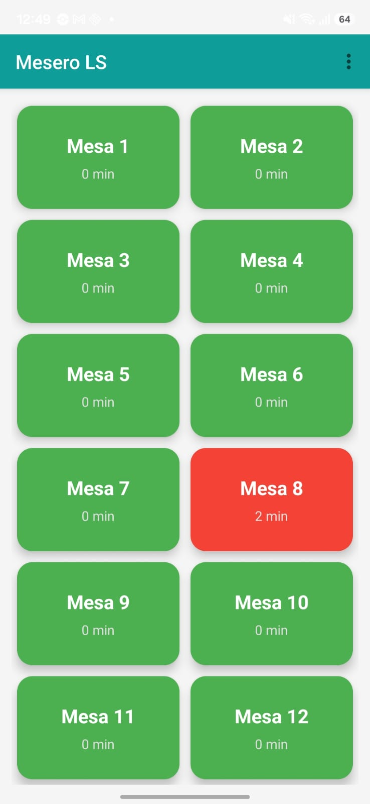
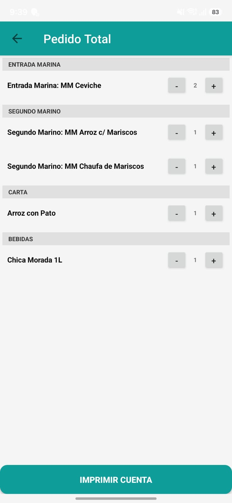
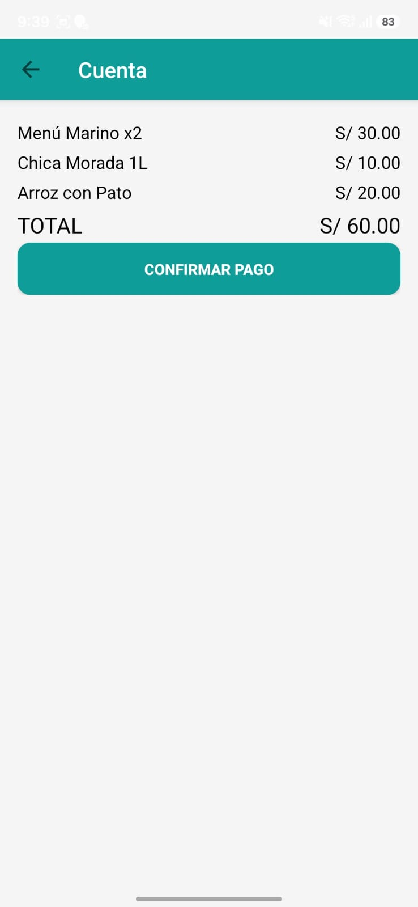
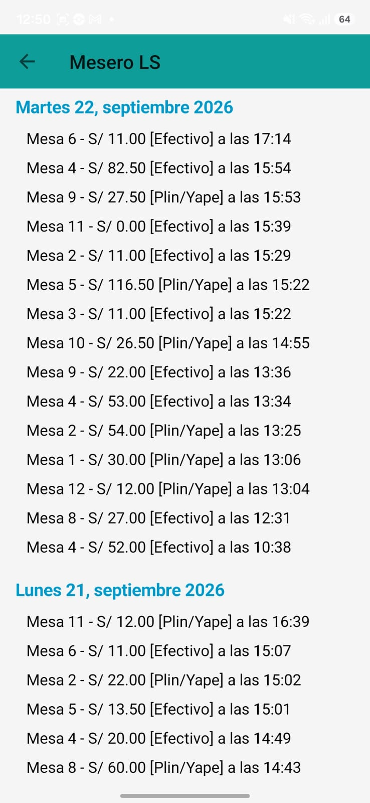
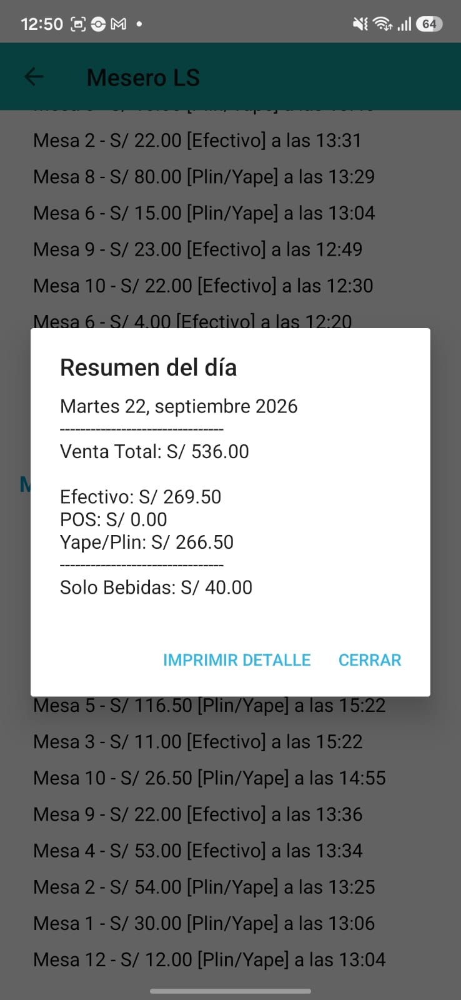
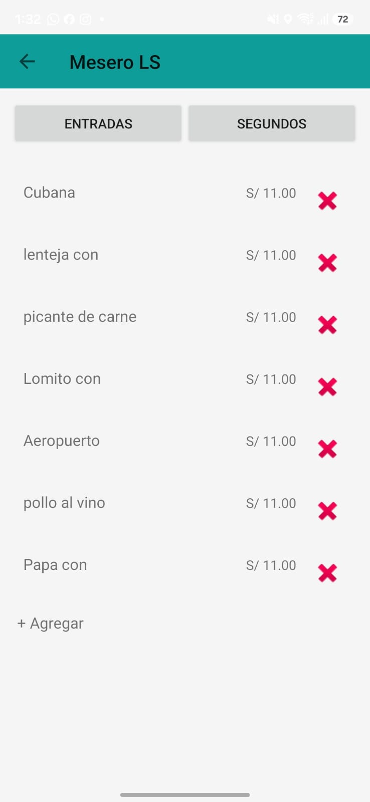

# MeseroLS

A comprehensive restaurant order management application that streamlines daily operations. MeseroLS enables staff to seamlessly dispatch, modify, and print orders, as well as automate billing. Through these core transactions, the system aggregates operational data to empower data-driven business decisions.

## Why it exists

MeseroLS runs in production at Las Sirenas, a restaurant in Lima, Peru. Waiters use it on a tablet to take orders table by table, send them to the kitchen, change them mid-service, and close the bill.

Every order, edit, cancellation, and payment is stored in Firestore as structured data instead of paper. So the same backend that runs the service also accumulates a real transaction history: what sold, when, in which combinations, how orders changed, and how customers paid. That history is the foundation for reporting and analytics on real operations, not just a way to speed up the floor.

## Features

**Order flow**
- Table-based order taking from a configurable menu (set menus, à la carte, drinks), with per-item comments and options.
- First send prints a kitchen ticket. Every later edit prints an update ticket that shows only what changed.
- Cancellations are attributed to the original order or to the specific update they came from (LIFO), so the kitchen ticket always reads correctly.

**Billing**
- Automatic totals, including the set-menu pricing rules.
- Payment by cash, card (POS), or Plin/Yape, plus compound payments split across methods, with live reconciliation before confirming.
- Receipts printed on the same thermal printer.

**History and data**
- Closed orders are saved per day with totals, payment method breakdown, and item-level detail.
- Daily sales summary and a printable itemized report.
- History screen protected by a PIN.

**Administration**
- Menu items and prices are editable from inside the app, without a new release.

## Screenshots

| Tables | Order | Bill |
|---|---|---|
|  |  |  |

| Order history | Daily summary | Menu editor |
|---|---|---|
|  |  |  |

## Tech stack

- **Language:** Kotlin, Android (View-based UI with XML layouts)
- **Backend:** Firebase Firestore, no custom server
- **Printing:** ESC/POS commands over TCP to a networked thermal printer
- **Build:** Gradle with Kotlin DSL and version catalogs

## Data model

| Collection | Purpose |
|---|---|
| `detalle_pedido` | Line items of the active order for each table |
| `detalle_pedido_temp` | Working copy used while an already-sent order is being edited |
| `actualizaciones_pedido` | Structured history of every edit, used to rebuild update tickets |
| `historial_dia` | Closed and paid orders, the base for sales history and analysis |

Edits are stored as structured deltas (item, quantity, group) rather than pre-rendered text, so tickets and reports can be regenerated at any time.

## Project structure

```
app/src/main/java/com/sebastianleguia/meserols/
├── MainActivity.kt              table selection and history access
├── PedidoActivity.kt            menu browsing and item selection
├── PedidoTotalActivity.kt       order review, send, and update logic
├── CuentaActivity.kt            billing and payment
├── HistorialActivity.kt         closed orders and daily summaries
├── ConfigurarMenuActivity.kt    menu and price editor
└── EthernetPrinterManager.kt    thermal printer communication
```

## Getting started

1. Clone the repository and open it in Android Studio.
2. Copy `local.properties.example` to `local.properties` and set your printer's IP and port and a backup PIN. This file is git-ignored.
3. Create a Firebase project with Firestore, register the Android app, and place your `google-services.json` in `app/`. See `app/google-services.json.example` for the expected shape.
4. Build and run.

Without a printer on the network the app still runs, but printing will fail.

## Notes

The interface is in Spanish, since it is used daily by Spanish-speaking staff.